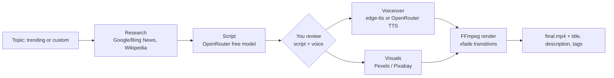

# YouTube Video Creator

Generates a finished video from a trending topic or any topic you type: research, script, voiceover, stock visuals, transitions, MP4 and SEO text. Next.js frontend, FastAPI backend, FFmpeg renderer.



## Requirements

- Python 3.11+
- Node 20+
- FFmpeg and ffprobe on `PATH`
- API keys: [OpenRouter](https://openrouter.ai), [Pexels](https://www.pexels.com/api/), [Pixabay](https://pixabay.com/api/docs/)

## Setup

```bash
cp .env.example .env        # fill in the three keys

cd backend
pip install -r requirements.txt
python -m uvicorn app.main:app --port 8000

cd ../frontend
npm install
npm run dev                 # http://localhost:3000
```

The frontend reads `NEXT_PUBLIC_API_URL` (default `http://localhost:8000`, see `frontend/.env.local.example`).

## Tests

```bash
cd backend && python -m pytest
```

## Notes

- **Free-tier limit:** OpenRouter allows 50 requests per day across free models, shared by script writing, research summaries and voices. The app stops early and shows the reset time when the limit is hit. Adding $10 of credit raises it to 1,000 per day.
- **Voices:** edge-tts is the default (no quota). HeyGen and Fish Audio voices via OpenRouter are opt-in in the voice picker and cost one request per scene.
- **Trends:** Google Trends and Google News feeds need no key. Reddit often blocks anonymous access and is skipped when it does.
- **Music:** `music/` is a placeholder; a track passed to the renderer is mixed in at low volume, but nothing uses it yet.
- Generated files live in `data/` (git-ignored).
